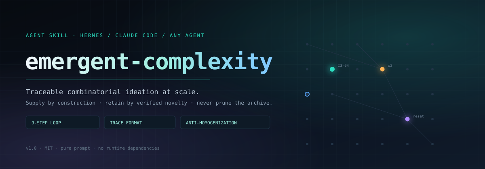
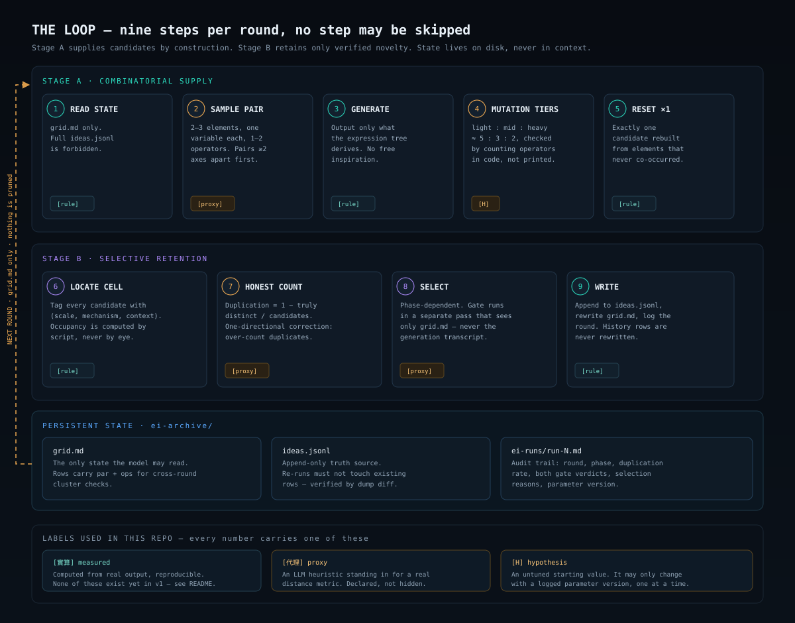
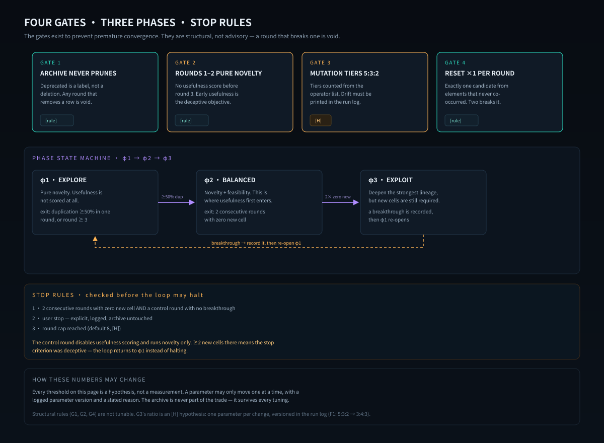
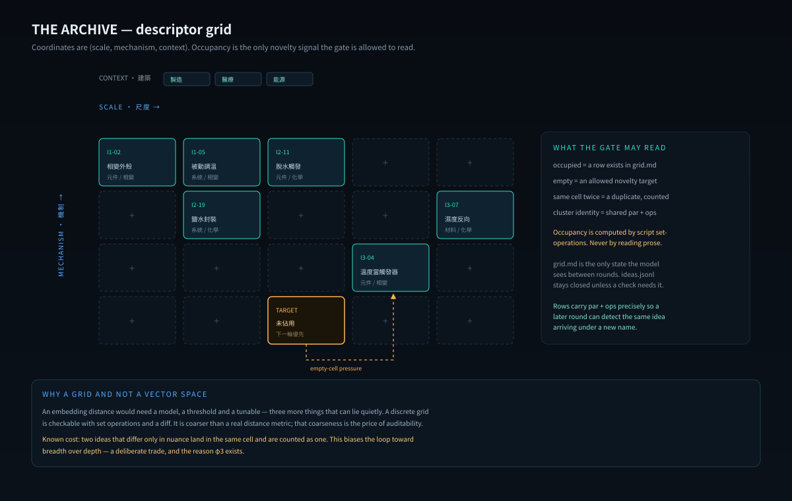
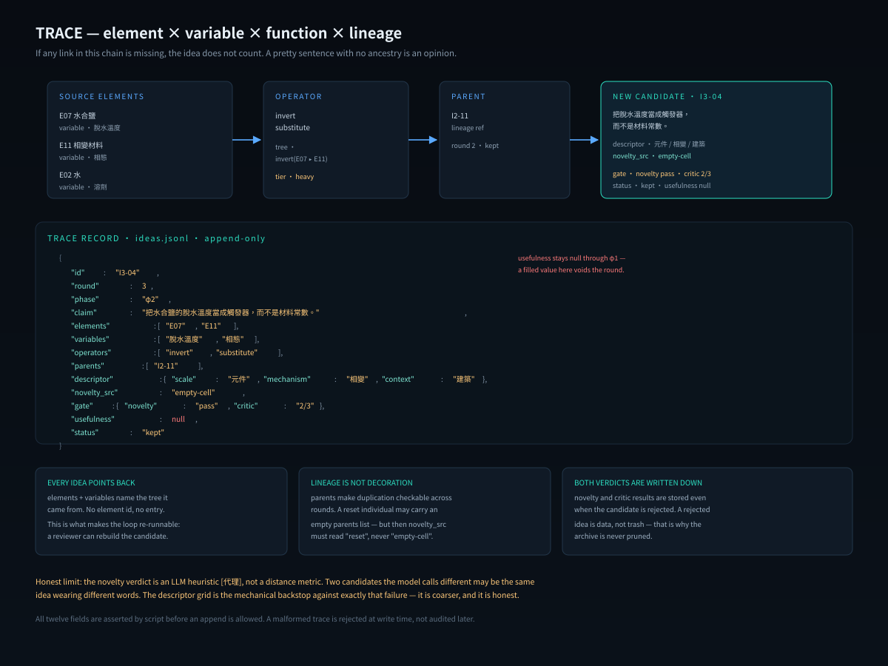

<p align="center">
  
</p>

<p align="center">
  
  
  
  
</p>

**emergent-complexity** 是一個 agent skill：它不問模型「給我 20 個點子」，而是把想法生成變成一場**有檔案、有計數、可驗收**的搜尋。

每個產出的想法都必須回答四個問題：它由哪些 **element** 組成、每個 element 被賦了什麼 **variable**、經過哪個 **function** 組合、以及它的 **lineage** 接到哪裡。答不出來的不算數。

> 一句話版本：**供給靠組合學，保留靠可驗證的新穎性，archive 永不刪。**

---

## 為什麼不是「叫 AI 想 20 個點子」

三件事讓一般 brainstorming 失效，而且都是實證過的：

| 失敗模式 | 證據 | 這個 skill 的對策 |
|---|---|---|
| 目標函數會欺騙搜尋 | novelty search 不看目標仍找到迷宮 39/40，看目標只有 3/40（P1） | 前兩輪**完全不評 usefulness**，只准開拓空 cell |
| 生成式 AI 提高個體創意、降低群體多樣性 | 同質化實證（P7） | 突變分層硬配額 5:3:2 + 每輪 1 個「從未同現」的重置個體 |
| 自己查新＝自己抄自己 | novelty gate 須獨立於生成者（P10） | 生成 pass 與判定 pass 兩段分離重入，判定只准讀 `grid.md` |

再加上一條工程紀律：**狀態在盤上，不在 context**。跨輪狀態只以檔案為準，context 只是工作副本。

---

## 快速開始

這是一份**單檔 skill**，沒有程式依賴、沒有 API key、沒有 build step。

```bash
# Hermes
mkdir -p ~/.hermes/profiles/<profile>/skills/emergent-complexity
cp SKILL.md ~/.hermes/profiles/<profile>/skills/emergent-complexity/

# Claude Code
mkdir -p ~/.claude/skills/emergent-complexity
cp SKILL.md ~/.claude/skills/emergent-complexity/
```

召喚條件（寫在 frontmatter 裡，agent 會自己判斷）：需要「新想法」且每個想法要能說出由哪些元件 × 變數賦值 × 組合函式構成；且**不准餵種子想法**。

```
/emergent-complexity 幫我為「離島淨水」發想 12 個新方案，要能溯源
```

第一輪之前，skill 會先做冷啟動：`mkdir -p ei-archive ei-runs`，凍結 5–15 個 ELEMENTS、凍結三軸 DESCRIPTOR，然後才進九步迴圈。

---

## 一輪長什麼樣

<p align="center">
  
</p>

九步，逐步照做，**不得跳步、併步或簡化**。環境不允許時只有一條降級路徑，而且必須自己宣告「降級模式：無持久化，重複率不跨輪」。

| # | 步驟 | 硬規則 |
|---|---|---|
| 1 | 讀狀態 | 只讀 `grid.md` + ELEMENTS + 上輪 run-log 尾部；**禁止讀 `ideas.jsonl` 全文** |
| 2 | 取樣配對 | 先碰撞再生成；優先選「三軸中 ≥2 軸不同格」的配對（P8） |
| 3 | 通過組合生成 | 只准輸出「由該表達樹導出的想法」，不得跳過樹直接寫靈感 |
| 4 | 突變分層 | 輕:中:重 ≈ 5:3:2【H】，須用腳本 assert，偏差即重分派 |
| 5 | 重置個體 | 每輪**恰 1 個**候選由 archive 中從未同現的兩 element 重造，不接 parent |
| 6 | 定位 descriptor cell | 每候選標 `(scale, mechanism, context)` 三軸座標 |
| 7 | 誠實計數 | 重複率 = 1 − 真不同數/候選數，走固定表 |
| 8 | 選擇 | 相位相依；每個保留/淘汰決定強制 1–2 句理由 |
| 9 | 寫出 | 想法全文 + trace append `ideas.jsonl`；改寫 `grid.md`；run-log 記參數版本 |

---

## 四道閘、三個相位、停止規則

<p align="center">
  
</p>

四閘是**結構性的，不是建議**——破了任何一道，那一輪作廢：

1. **archive 永不淘汰**：`deprecated` 只是標籤，不是刪除。任何刪掉一列的輪次作廢。
2. **前 2 輪純 novelty**：第 3 輪之前不准打 usefulness 分數。早熟的 usefulness 就是那個騙人的目標函數。
3. **突變分層 5:3:2**：配額從算子清單統計，漂移必須印進 run log。
4. **每輪恰 1 個重置個體**：只由 archive 裡從未同現的兩 element 重造。兩個就破閘。

相位由重複率**動態觸發**，不是「先發散後收斂」那種靜態排程：

| 相位 | 進入條件 | 選擇準則 |
|---|---|---|
| φ1 純 novelty | 預設起點（前 2 輪強制） | 只保留開拓空 cell／遠 cell 的候選 |
| φ2 novelty + usefulness | 重複率 ≥50% 連續 1 輪，或第 3 輪起 | usefulness 當否決票，不當分數 |
| φ3 雙軸並重 | φ2 連續 2 輪無新 cell | novelty × usefulness 獨立評，**禁單一總分** |

停止規則是三條 AND/OR 明確的硬條件，其中一條特別值得注意：**停止前必須跑一輪「關閉所有評分、只數 novelty」的對照輪**。如果對照輪還能生出 ≥2 個新 cell，那就證明原本的停止準則是 deceptive，迴圈要回 φ1，不能收工。

---

## 檔案結構：狀態在盤上

<p align="center">
  
</p>

```
<workspace>/ei-archive/
  ELEMENTS.md        # id / 名詞 / 一句機制 / variable 槽（5–15，run 1 前凍結）
  grid.md            # 每輪整檔改寫；每 cell 的駐留者 + par + ops（唯一天然索引）
  ideas.jsonl        # append-only 真相源；重跑不得改歷史列
<workspace>/ei-runs/
  run-N.md           # 輪次 / 相位 / 重複率 / 兩段結論 / 選擇理由 / 參數版本
```

`grid.md` 是整個設計的樞紐：它同時是**索引**、**佔用表**、和 novelty 判定的**唯一輸入**。判定 pass 只准讀它——不准回讀候選全文重判。佔用比對要用腳本做集合運算，不准目測：把同 cell 誤判成異 cell 會低估重複率，直接破壞相位觸發。

`grid.md` 損毀時有一句必須一字不改的重建句：*重建＝python3 逐列讀 ideas.jsonl，對每 cell 取 body 最長列為最佳 id，重寫 grid.md，列數與 cell 數記入 run-log。*

---

## Trace 格式：可溯源是驗收項

<p align="center">
  
</p>

```json
{"id":"I3-04","run":3,"seq":4,
 "tree":{"elements":["E02","E07"],"vars":{"E02":"水","E07":"水合鹽"},
         "funcs":["substitute(E07->E02)"],"parents":["I2-11"]},
 "operators":["substitute"],
 "descriptor":{"scale":"device","mechanism":"phase-change","context":"建築"},
 "claim":"<一句話>","body":"<≤120字>",
 "novelty_src":"判定pass結論＋空cell理由","usefulness_src":"critic評語或null",
 "selection":"保留：開拓空cell；變體v2同cell較弱已併","phase":"phi1"}
```

驗收時逐欄檢查：`id`、`run/seq`、`tree.elements`（∈ELEMENTS）、`tree.vars`、`tree.funcs`、`tree.parents`、`operators`（∈六算子）、`descriptor`（三軸齊）、`claim/body`、`novelty_src`、`usefulness_src`、`selection`、`phase`。

沿 `tree.parents` 遞迴必須能走回 ELEMENTS，沿途每一步都有 operator 與 variable 賦值。**任一環缺失，這個想法就不算數**——一句漂亮的句子如果沒有祖先，那只是意見。

---

## 憑據表（13 條）

程序步驟旁只標 `P#n`，不展開論證。降級路徑與 H 值只能寫「設計假說／待試跑值」，不得寫「文獻支持」。

| # | 主張 | 來源 |
|---|---|---|
| P1 | 目標函數會欺騙搜尋；novelty search 不看目標仍迷宮 39/40 vs 3/40；ρ(x)=k 近鄰平均距離、量 phenotype、永久 archive | [Lehman, Novelty Search (2011)](https://www.cs.swarthmore.edu/~meeden/DevelopmentalRobotics/lehmanNoveltySearch11.pdf) |
| P2 | Quality-Diversity：行為空間網格化、每 cell 保最佳 elite（MAP-Elites）；實作庫 pyribs | [arXiv 1504.04909](https://arxiv.org/abs/1504.04909) · [pyribs](https://github.com/icaros-usc/pyribs) |
| P3 | 組合爆炸＝湧現引擎；「build the blocks, not the set」；新穎性由組合學保證 | [影片](https://www.youtube.com/watch?v=0HqUYpGQIfs) |
| P4 | 弱湧現＝可導出但出乎意料 → 組合輸出可溯源即可驗收 | [consc.net/papers/emergence.pdf](https://consc.net/papers/emergence.pdf) |
| P5 | 層級自主性：每層級有自己的定律語彙（More is Different） | [Science 177:4047](https://www.science.org/doi/10.1126/science.177.4047.393) |
| P6 | 創造力雙準則：originality 必要不充分；隨機過程常只產「僅僅原創」 | [Runco & Jaeger 2012](https://richardcolby.net/writ2000/wp-content/uploads/2017/09/Runco-and-Jaeger-2012-standard-definition-of-creativity.pdf) |
| P7 | 生成式 AI 提高個體創意、降低群體多樣性（同質化實證） | [Science Advances adn5290](https://www.science.org/doi/10.1126/sciadv.adn5290) |
| P8 | 先碰撞後生成：先取結構遙遠原理、強迫通過它生成（bisociation 操作化） | [open-collider](https://github.com/CL-ML/open-collider) |
| P9 | 並行異質 critic 勝過序列回饋（7,000 點子消融） | [arXiv 2507.08350](https://arxiv.org/abs/2507.08350) |
| P10 | novelty gate 須獨立於生成者（自己查新＝自己抄自己） | [AI-Scientist](https://github.com/SakanaAI/AI-Scientist) · [SciAgents](https://github.com/lamm-mit/SciAgentsDiscovery) |
| P11 | GP bloat：尺寸成長而適應度停滯；parsimony 為對應藥方 | [Springer 10.1007/s11063-021-10497-8](https://link.springer.com/article/10.1007/s11063-021-10497-8) |
| P12 | 自組織與選擇聯姻、edge of chaos；耗散結構需持續漲落 | [Oxford](https://academic.oup.com/book/53153) · [Prigogine 1977](https://www.nobelprize.org/prizes/chemistry/1977/prigogine/lecture/) |
| P13 | 表達樹（leaf=variable/inner=function）＋突變＋人擇＝可執行骨架 | [影片](https://www.youtube.com/watch?v=DB-TD3s3MZ0) |

---

## 壞掉的時候：8 列處置表

| # | 現象 | 怎麼測 |
|---|---|---|
| F1 | 重複率連續 ≥50% | `grep -oE '重複率[=:：] ?[0-9.]+ ?%' ei-runs/*.md \| tail -4`，最近 2 輪皆 ≥50% 即成立 → 突變比例改 3:4:3（記參數版本列） |
| F2 | 候選擠同 cell | 對 `grid.md` 統計 cell 占用，單 cell ≥ 本輪候選半數 → 軸距判準加嚴；2 run 擠塞則改軸重開 |
| F3 | run-log 缺欄 | 對六必填欄逐項 `grep -c`，任一 0 ＝缺欄 → 補齊後該輪重結算 |
| F4 | trace 欄位不全 | 逐列跑欄位檢查，報缺欄 id 清單 → 補齊方可入計數 |
| F5 | `ideas.jsonl` 損毀 | 逐列 `json.loads`，報第一個壞列行號 → 走損毀復原 SOP（壞尾隔離、只 append、全量重建 grid） |
| F6 | grid 與 jsonl 不一致 | 對每 cell「最佳 id」反查 jsonl，0 ＝幽靈 id → 以 jsonl 為準重建 grid |
| F7 | bloat 超標 | `len(body)>120` 計數、同 parent 變體 >3 清單 → parsimony 併變體、截斷 |
| F8 | H 值無記錄變更 | diff run-log 尾「參數版本」列與參數表 → 補記；此後一次只動一個參數 |

---

## 驗收自測（8 項，每輪勾選）

`12.1` 裸執行 ×2 各 ≥10 想法、不讀入種子｜`12.2` 兩輪重複率 <50%｜`12.3` trace 100% 可溯源｜`12.4` T4 缺欄演練零缺欄｜`12.5` 結構自查（frontmatter／jsonl 可 parse／歷史列 diff 不變）｜`12.6` 無裸數值宣稱、H 值變更皆有版本列｜`12.7` 對照組四指標，敗則記敗因｜`12.8` 優質互異核心數（觀察期；連續 5 真 run S≥B 才升格為硬門）

---

## 誠實邊界

這個 skill 刻意把自己的不確定性寫在正文裡，而不是藏在附錄：

- **`[代理]`**：重複率判定是 LLM 啟發式代理，不是 embedding 餘弦或 pyribs 實算 ρ。實算鉤子留給外部工具，對拍與誤差模式另檔記錄。
- **`[H]`**：突變比例、門檻、輪數上限、bloat cap 全部是**待試跑值**，不是量測值。任何改動必須留參數版本列，一次只動一個。
- **單體式妥協**：§4.4 的「兩段分離重入」是同一個 agent 的兩 pass，不是真正的獨立 agent。真獨立版留待擴充。
- **無 runtime 降級**：沒有檔案寫入能力時可在單輪 context 內跑完九步，但必須宣告「降級模式」，且不得宣稱通過結構自查的跨輪項。

---

## 不做什麼

- 不適合「使用者已經有明確答案」的場合，也不適合純彙整既有清單、純文字潤飾。
- 不餵種子想法：ELEMENTS 從任務領域本身萃取，不從既有想法清單逆向萃取。
- 不追求單一總分：φ3 的 novelty × usefulness 必須獨立評，任何環節禁單一總分。
- 不會為了收斂而刪 archive：調參可以改門檻，不能動檔案。

---

## Repo 結構

```
SKILL.md              # 完整 skill 本體（249 行，單檔）
assets/hero.svg       # 封面
assets/loop.svg       # 九步迴圈
assets/gates.svg      # 四閘 · 三相 · 停止規則
assets/grid.svg       # descriptor grid archive
assets/trace.svg      # trace 四元組
LICENSE               # MIT
```

---

## License

MIT — 見 [LICENSE](LICENSE)。

Skill 內引用的 13 條文獻屬各自原作者；本 repo 只引用連結與一句摘要，不轉載內容。
